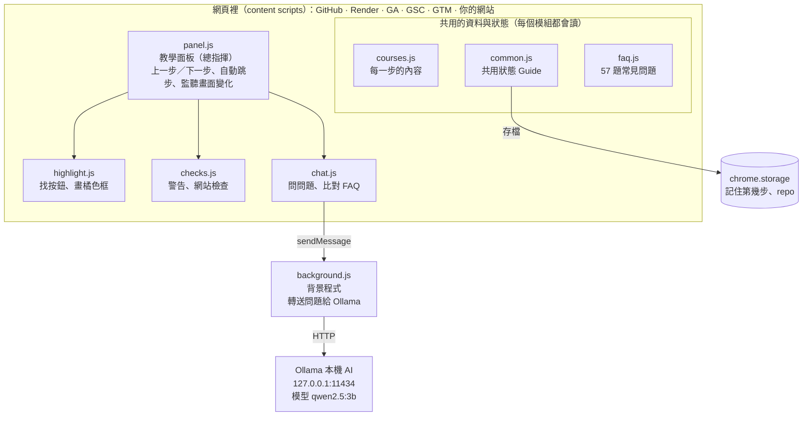

# GitHub Guide Extension 專案架構說明

2026-10-18

## 專案簡介

這是一個 Chrome 擴充功能（manifest v3，版本 5.0），在網頁右下角放一個教學面板，一步一步帶初學者用 GitHub Pages 或 Render 發布網站，再接上 GA、GSC、GTM 和 Sitemap。整個專案是純 JavaScript，共 12 個檔案、約 2,750 行，沒有打包工具，也沒有後端伺服器。

面板會做四件事：

- **教學步驟**：選一套教學（共 14 套，分 GitHub Pages、Render、VS Code、SEO 幾組），面板顯示目前這一步要做什麼。
- **標示按鈕**：在 GitHub 等網站上把這一步要按的按鈕框成橘色，並在下方放提示文字；做完會自動跳下一步。
- **錯誤提醒**：偵測常見錯誤（repo 是 Private、檔名不是 index.html、Custom domain 格式錯等），用黃色警告提醒。
- **問問題**：先用關鍵字比對內建的 57 題常見問題；答不出來再交給使用者電腦上的 Ollama（本機 AI）回答。

面板會出現在 GitHub、Render、GA、GSC、GTM、xml-sitemaps.com，以及使用者自己的網站（`*.github.io`、`*.onrender.com`）。在自己的網站上會多一個「網站檢查」，檢查 GA／GTM 程式碼、sitemap.xml 和 robots.txt。

## 整體架構

程式分成兩塊：塞進網頁裡跑的 content scripts（面板、標示、檢查、問答都在這裡），和一個只負責連 AI 的背景程式。

`panel.js` 是總指揮：畫面一變就叫 `highlight.js` 重新框按鈕、叫 `checks.js` 重新檢查錯誤。只有問問題且常見問題答不出來時，`chat.js` 才會把問題傳給 `background.js`，再由它連到使用者電腦上的 Ollama。

### 一次操作的流程

1. 使用者打開 GitHub，Chrome 依 `manifest.json` 的順序載入 7 個 content scripts。
2. `panel.js` 從 `chrome.storage` 讀出上次的進度（哪套教學、第幾步），畫出面板。
3. 依目前這一步的 `targets`，`highlight.js` 在頁面上找按鈕並框起來；`checks.js` 檢查有沒有常見錯誤。
4. 使用者點了框起來的按鈕，或網址變成下一個頁面，`panel.js` 就自動跳下一步並存檔。
5. GitHub 換頁不會重新載入，所以 `MutationObserver` 一看到畫面變化，就回到第 3 步重新掃描。

## 使用技術

全部用瀏覽器內建的功能寫成，沒有任何第三方套件（沒有 React、沒有 npm）。改完檔案到 `chrome://extensions` 按重新載入就能測。

| 技術 | 用在哪裡 | 白話解釋 |
| --- | --- | --- |
| Chrome Extension Manifest V3 | `manifest.json` | Chrome 擴充功能的設定檔，決定程式要在哪些網站執行、有哪些權限 |
| Content scripts | `common.js` 等 7 個檔案 | 「塞進別人網頁」執行的程式，可以讀和改 GitHub 頁面上的東西 |
| Service worker（背景程式） | `background.js` | 在後台跑的程式，負責連到本機的 Ollama（網頁裡的程式不能直接連） |
| 原生 JavaScript（ES2022） | 所有 `.js` | 沒有框架，用 `document.querySelector`、`innerHTML` 直接操作畫面 |
| `chrome.storage.local` | `common.js` 的 `setState` | 記住選哪套教學、第幾步、repo 名稱、GA／GTM ID，換頁換網站都記得 |
| `chrome.runtime.sendMessage` | `chat.js` → `background.js` | 面板和背景程式之間傳訊息 |
| MutationObserver | `panel.js` | GitHub 換頁不會重新載入，所以監聽畫面變化，一變就重新找按鈕、檢查錯誤 |
| CSS（單一檔案） | `guide.css` | 面板、橘色框、警告的外觀 |
| Ollama 本機 AI | `background.js` | 裝在使用者電腦上的 AI，網址 `http://127.0.0.1:11434`，預設模型 `qwen2.5:3b`（約 2 GB） |

想用 AI 回答的人要自己裝 Ollama、下載模型，並設定 `OLLAMA_ORIGINS`；不裝的話只有常見問題能用。

## 檔案導覽

所有檔案都在 `github-repo-guide/` 資料夾。只想改教學內容的人，只需要碰 `courses.js` 和 `faq.js`。

| 檔案 | 行數 | 負責什麼 | 什麼時候改它 |
| --- | --- | --- | --- |
| `courses.js` | 831 | 每套教學的每一步：標題、說明、要框的按鈕、該在哪個頁面、什麼時候算完成 | 加教學、改步驟說明、網站改版按鈕找不到 |
| `faq.js` | 444 | 57 題常見問題，每題有關鍵字和答案 | 加新問題 |
| `guide.css` | 336 | 面板和橘色框的外觀 | 改樣式 |
| `checks.js` | 247 | 黃色錯誤提醒、「網站檢查」、在 GA／GTM 頁面自動記下 ID | 加新的錯誤偵測 |
| `panel.js` | 234 | 建立面板、上一步／下一步、自動跳下一步、監聽畫面變化；把其他檔案接起來 | 改面板行為 |
| `background.js` | 183 | 連 Ollama 回答問題（另有截圖找按鈕的程式，目前沒有被呼叫） | 換 AI 模型、改提示詞 |
| `chat.js` | 133 | 「問問題」對話框、關鍵字比對常見問題 | 改問答邏輯 |
| `common.js` | 119 | 共用工具、網址規則、全域狀態 `Guide.state` 和 `setState` | 加新網站、新狀態欄位 |
| `highlight.js` | 76 | 找按鈕（CSS 選擇器或按鈕文字）、畫橘色框和提示 | 改標示方式 |
| `manifest.json` | 27 | 擴充功能設定：在哪些網站執行、權限、載入順序 | 加新網站、加權限 |

載入順序很重要：`common.js → courses.js → faq.js → highlight.js → checks.js → chat.js → panel.js`。每個檔案把自己的功能掛到全域物件 `Guide` 上，後面的檔案再從 `Guide` 拿，所以順序不能交換。

### 一個步驟長什麼樣子

`courses.js` 裡每一步是一個物件，常用欄位：

- `title`、`body`：標題和說明（說明可以寫 HTML）
- `targets`：要框的按鈕，用 `selector`（CSS 選擇器）或 `text`（按鈕上的字）找；加 `done: true` 表示點了就算完成
- `page`、`pageName`、`goto`：這一步該在哪個頁面做、「帶我過去」的網址
- `doneWhen`：完成條件（通常是網址變了），從「不成立」變「成立」時自動跳下一步
- `checkFileName`、`checkIndex`、`checkGaStream`、`checkGscPrefix`：開啟 `checks.js` 裡的額外檢查

## 目前的缺點

最大的風險是「網站一改版就壞」和「專案沒有版本控制，多人一起改容易互相覆蓋」。下表依影響大小排序。

| 缺點 | 為什麼是問題 | 建議怎麼改 |
| --- | --- | --- |
| 靠按鈕文字和 CSS 選擇器找按鈕 | GitHub、Render、Google 一改版，橘色框就消失，只剩「找不到按鈕」的警告；目前只能靠有人發現後手動改 `courses.js` | 每個步驟多給幾組備用選擇器；定期（例如每月）把每套教學走一遍 |
| 專案不是 git repo | 沒有修改紀錄，改壞無法還原；組員互傳檔案容易互相覆蓋 | `git init` 並放到 GitHub，每個人開自己的 branch、用 PR 合併 |
| 完全沒有測試 | 改了 `common.js` 或 `checks.js` 不知道有沒有弄壞別的教學，只能一個一個手動點 | 先替純邏輯加單元測試（`domainProblem`、`matchFaq`、`siteUrl`），再考慮用 Playwright 跑主要教學 |
| `background.js` 有一段用不到的程式 | 「截圖後請 AI 找按鈕」（`capture`、`findTarget`）沒有任何檔案呼叫；它需要的 `<all_urls>` 權限和設定頁（`openOptions`）也沒寫在 `manifest.json` | 決定要做完還是刪掉；保留的話要在 `manifest.json` 加 `optional_host_permissions` 和設定頁 |
| GA、GSC、GTM 的步驟不會自動跳下一步 | Google 的網址規則還沒確認，這些步驟只能手動按「下一步」，體驗和 GitHub 教學不一致（`TODO.md` 有記） | 整理 Google 後台各頁的網址，照 GitHub 的做法加 `doneWhen` |
| AI 功能門檻高 | 要自己裝 Ollama、下載 2 GB 模型、在 cmd 設環境變數；對初學者來說比建網站本身還難。3B 小模型回答品質有限，慢的電腦要等很久（逾時設 180 秒） | 繼續擴充 `faq.js`，讓大部分問題不用 AI；或評估改用雲端 AI（要處理金鑰和費用） |
| `OLLAMA_ORIGINS "chrome-extension://*"` 太寬 | 這個設定讓電腦上**所有**擴充功能都能使用 Ollama，而 Ollama 沒有密碼 | 改成只允許這個擴充功能的 ID：`chrome-extension://<擴充功能 ID>` |
| 常見問題只用關鍵字比對 | 只要問題裡出現某個字就算符合，換個說法就找不到，短關鍵字也可能誤判 | 累積使用者實際問的問題來補關鍵字；或讓 AI 先從常見問題裡挑 |
| 效能：畫面一變就重新掃描 | `MutationObserver` 監聽整個頁面，每次變化都重找按鈕、重跑所有檢查；每次重畫又排一個 4 秒後的掃描；GA／GTM 頁面每 3 秒讀一次整頁文字。大頁面可能變卡 | 加節流（例如最多每 300 毫秒掃一次），只在有需要的頁面跑對應的檢查 |
| 程式結構靠全域物件和載入順序 | 所有檔案共用一個 `Guide`，順序錯就壞；`render()` 有時直接改 `state.step`，沒經過 `setState`，不會存檔 | 檔案變多時改用 ES module + 打包工具（如 Vite）；規定狀態只能用 `setState` 改 |
| 教學內容和程式碼混在一起 | 說明文字是寫在 JavaScript 裡的 HTML 字串，不會寫程式的組員不好改；只有繁體中文，不能換語言 | 把文字抽到 JSON 或 Markdown，程式只管邏輯 |
| 只記得一個進度 | 換一套教學就回到第 1 步，切回來原本的進度沒了 | 改成每套教學各自存進度 |
| 在所有人的 `*.github.io` 網站都會出現面板 | 逛別人的 GitHub Pages 網站時也會跳出教學面板和網站檢查 | 只在網址符合使用者自己 repo 的網站自動打開，其他網站預設收起 |
