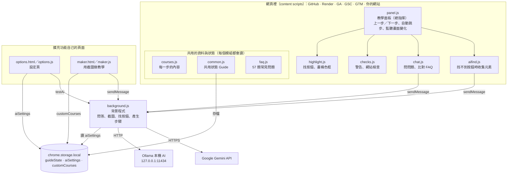

# GitHub Guide Extension 專案架構說明

2026-10-30（對應 manifest 版本 6.1）

## 專案簡介

這是一個 Chrome 擴充功能（manifest v3，版本 6.1），在網頁右下角放一個教學面板，一步一步帶初學者用 GitHub Pages 或 Render 發布網站，再接上 GA、GSC、GTM 和 Sitemap。整個專案是純 JavaScript，共 14 個程式和設定檔、約 4,100 行，沒有打包工具，也沒有自己的後端伺服器。

面板會做這些事：

- **教學步驟**：選一套教學（內建 14 套，分「架網站」和「SEO」兩組，另外還有使用者用截圖做的「我的教學」），面板顯示目前這一步要做什麼。
- **標示按鈕**：在 GitHub 等網站上把這一步要按的按鈕框成橘色，並在下方放提示文字；做完會自動跳下一步。按鈕在畫面外時會提示或自動捲過去，被網頁的對話框蓋住時會先把框藏起來。
- **錯誤提醒**：偵測常見錯誤（repo 是 Private、檔名不是 index.html、Custom domain 格式錯等），用黃色警告提醒。
- **問問題**：先用關鍵字比對內建的 57 題常見問題；答不出來再交給 AI。
- **AI 找按鈕**：網站改版、按鈕 4 秒內找不到時，截圖並編號畫面上的元素，請 AI 選出正確的按鈕，用紫色虛線框標出來，並記到「改版紀錄」。
- **用截圖做教學**：上傳操作截圖，AI 寫出步驟，修改後存成自己的教學，可以匯出、匯入 JSON。

AI 有兩種可以選（在設定頁切換）：

- **Ollama**：裝在使用者電腦上的本機 AI，網址 `http://127.0.0.1:11434`，文字模型 `qwen2.5:3b`、看圖模型 `qwen2.5vl:3b`。資料不會傳到網路上。
- **Google Gemini API**：要在設定頁貼上 API key，預設模型 `gemini-3.5-flash-lite`（能看圖）。

面板會出現在 GitHub、Render、GA、GSC、GTM、xml-sitemaps.com，以及使用者自己的網站（`*.github.io`、`*.onrender.com`）。在自己的網站上會多一個「網站檢查」，檢查 GA／GTM 程式碼、sitemap.xml 和 robots.txt。

## 整體架構

程式分成三塊：塞進網頁裡跑的 content scripts（面板、標示、檢查、問答、AI 找按鈕都在這裡）、一個負責連 AI 和截圖的背景程式，以及兩個擴充功能自己的頁面（設定頁、用截圖做教學）。

每個函數怎麼互相呼叫，請看 [FLOWCHART.md](FLOWCHART.md) 的流程圖。

`panel.js` 是總指揮：畫面一變就叫 `highlight.js` 重新框按鈕、叫 `checks.js` 重新檢查錯誤；按鈕找不到時叫 `aifind.js` 請 AI 幫忙。所有要用 AI 的地方（問問題、找按鈕、截圖做教學、測試連線）都用 `chrome.runtime.sendMessage` 交給 `background.js`，由它依設定頁的選擇連到 Ollama 或 Gemini。

### 一次操作的流程

1. 使用者打開 GitHub，Chrome 依 `manifest.json` 的順序載入 8 個 content scripts。
2. `panel.js` 從 `chrome.storage` 讀出上次的進度（哪套教學、第幾步），畫出面板。
3. 依目前這一步的 `targets`，`highlight.js` 在頁面上找按鈕並框起來；`checks.js` 檢查有沒有常見錯誤。
4. 使用者點了框起來的按鈕，或網址變成下一個頁面，`panel.js` 就自動跳下一步並存檔。
5. GitHub 換頁不會重新載入，所以 `MutationObserver` 一看到畫面變化，就回到第 3 步重新掃描。
6. 這一步顯示超過 4 秒還是找不到任何按鈕，而且面板上「找不到按鈕時請 AI 看畫面」有打開，就進入下面的「AI 找按鈕」流程。

### AI 找按鈕的流程

1. `aifind.js` 收集畫面上看得到、可以點或填的元素（最多 50 個），編號。
2. `background.js` 的 `capture` 用 `chrome.tabs.captureVisibleTab` 截圖，在每個元素上畫粉紅色框和編號。需要 `<all_urls>` 權限（設定頁開），而且選的 AI 要能看圖；條件不符就跳過截圖，只送元素清單。
3. `background.js` 的 `findTarget` 把步驟說明、原本的線索、元素清單（和截圖）交給 AI，AI 回答一個編號。
4. `aifind.js` 把那個元素變成之後還找得到的 target，`highlight.js` 用紫色虛線框標出來，點了一樣會自動跳下一步。
5. 結果存在 `guideState.aiFound`，key 是「步驟＋網址」（GA、GTM 這種網址 `#/` 後面才不同的頁面，也會把 `#/…` 算進去）。同一頁不會再問一次；設定頁可以看到這些紀錄。

### 用截圖做教學的流程

1. 面板最下面按「📷 用截圖做新教學」，`background.js` 開新分頁 `maker.html`。
2. `maker.js` 把截圖縮小成最寬 1280、最高 2000 的 JPEG，一張一張送給 `background.js` 的 `makeSteps`，AI 回傳 JSON 格式的步驟（標題、說明、按鈕文字、網址）。
3. 使用者修改後儲存到 `chrome.storage` 的 `customCourses`。
4. `courses.js` 的 `setCustomCourses` 把這些純資料換成一般步驟（用按鈕文字找按鈕、點最後一個按鈕就完成），出現在面板下拉選單的「我的教學」。

## 使用技術

全部用瀏覽器內建的功能寫成，沒有任何第三方套件（沒有 React、沒有 npm）。改完檔案到 `chrome://extensions` 按重新載入就能測。

| 技術 | 用在哪裡 | 白話解釋 |
| --- | --- | --- |
| Chrome Extension Manifest V3 | `manifest.json` | Chrome 擴充功能的設定檔，決定程式要在哪些網站執行、有哪些權限 |
| Content scripts | `common.js` 等 8 個檔案 | 「塞進別人網頁」執行的程式，可以讀和改 GitHub 頁面上的東西 |
| Service worker（背景程式） | `background.js` | 在後台跑的程式，負責連 AI 和截圖（網頁裡的程式不能直接做） |
| 擴充功能頁面 | `options.html`、`maker.html` | 擴充功能自己的網頁，可以直接用 `chrome.*` API |
| 原生 JavaScript（ES2022） | 所有 `.js` | 沒有框架，用 `document.querySelector`、`innerHTML` 直接操作畫面 |
| `chrome.storage.local` | `common.js`、`options.js`、`maker.js` | `guideState`：選哪套教學、第幾步、repo、GA／GTM ID、AI 找到的按鈕；`aiSettings`：用哪個 AI、Gemini key；`customCourses`：截圖做的教學 |
| `chrome.runtime.sendMessage` | `chat.js`、`aifind.js`、`maker.js`、`options.js` → `background.js` | 頁面和背景程式之間傳訊息，訊息種類見下方 |
| `chrome.permissions`（選用權限） | `options.js`、`background.js` | 使用者在設定頁同意後才取得 `<all_urls>`，用來截圖 |
| `chrome.tabs.captureVisibleTab`、`OffscreenCanvas` | `background.js` | 截圖並在上面畫元素編號 |
| MutationObserver | `panel.js` | GitHub 換頁不會重新載入，所以監聽畫面變化，一變就重新找按鈕、檢查錯誤 |
| `document.elementFromPoint` | `highlight.js` | 判斷按鈕有沒有被網頁的對話框或遮罩蓋住 |
| CSS（單一檔案） | `guide.css` | 面板、橘色框、紫色框、警告的外觀 |
| Ollama／Gemini | `background.js` | 回答問題、看截圖找按鈕、看截圖寫步驟 |

`background.js` 接受的訊息：

| `type` | 誰送的 | 做什麼 |
| --- | --- | --- |
| `ask` | `chat.js` | 回答使用者的問題 |
| `capture` | `aifind.js` | 截圖並畫上元素編號 |
| `findTarget` | `aifind.js` | 請 AI 從元素清單選出這一步的按鈕 |
| `makeSteps` | `maker.js` | 看一張截圖寫出步驟 |
| `testAi` | `options.js` | 測試 AI 連不連得上 |
| `openOptions` | 面板 | 打開設定頁 |
| `openMaker` | 面板 | 開新分頁打開 `maker.html` |

用 Ollama 的人要自己裝 Ollama、下載模型，並設定 `OLLAMA_ORIGINS`；用 Gemini 的人要申請 API key。兩個都沒設定的話，只有常見問題能用。

## 檔案導覽

所有檔案都在 `github-repo-guide/` 資料夾。只想改教學內容的人，只需要碰 `courses.js` 和 `faq.js`；也可以不寫程式，用「用截圖做教學」做新教學。

| 檔案 | 行數 | 負責什麼 | 什麼時候改它 |
| --- | --- | --- | --- |
| `courses.js` | 1,023 | 每套教學的每一步：標題、說明、要框的按鈕、該在哪個頁面、什麼時候算完成；把截圖做的教學換成一般步驟 | 加教學、改步驟說明、網站改版按鈕找不到 |
| `faq.js` | 444 | 57 題常見問題，每題有關鍵字和答案 | 加新問題 |
| `maker.js` | 419 | 「用截圖做教學」頁面：上傳截圖、AI 產生步驟、修改、儲存、匯出匯入 | 改截圖做教學的流程 |
| `panel.js` | 417 | 建立面板、上一步／下一步、自動跳下一步、監聽畫面變化、AI 找按鈕的開關和結果；把其他檔案接起來 | 改面板行為 |
| `guide.css` | 397 | 面板、橘色框、紫色框和提示的外觀 | 改樣式 |
| `background.js` | 309 | 連 Ollama 或 Gemini（問答、找按鈕、產生步驟、測試連線）、截圖並畫編號、開設定頁和截圖做教學頁 | 換 AI 模型、改提示詞 |
| `checks.js` | 247 | 黃色錯誤提醒、「網站檢查」、在 GA／GTM 頁面自動記下 ID | 加新的錯誤偵測 |
| `chat.js` | 133 | 「問問題」對話框、關鍵字比對常見問題 | 改問答邏輯 |
| `aifind.js` | 132 | 找不到按鈕時收集畫面上的元素、請背景程式截圖和問 AI、把結果變成 target | 改 AI 找按鈕的方式 |
| `highlight.js` | 129 | 找按鈕（CSS 選擇器、按鈕文字，或兩者一起）、畫橘色框和提示、判斷被蓋住或在畫面外 | 改標示方式 |
| `options.js` | 125 | 設定頁：選 AI、填 Gemini key、測試連線、截圖權限、AI 找到的按鈕紀錄 | 加新設定 |
| `common.js` | 121 | 共用工具、網址規則、全域狀態 `Guide.state` 和 `setState` | 加新網站、新狀態欄位 |
| `maker.html` | 110 | 「用截圖做教學」頁面的畫面 | 改這頁的版面 |
| `options.html` | 82 | 設定頁的畫面 | 改設定頁版面 |
| `manifest.json` | 47 | 擴充功能設定：在哪些網站執行、權限、載入順序、設定頁 | 加新網站、加權限 |

載入順序很重要：`common.js → courses.js → faq.js → highlight.js → checks.js → chat.js → aifind.js → panel.js`。每個檔案把自己的功能掛到全域物件 `Guide` 上，後面的檔案再從 `Guide` 拿，所以順序不能交換。

### 一個步驟長什麼樣子

`courses.js` 裡每一步是一個物件，常用欄位：

- `title`、`body`：標題和說明（說明可以寫 HTML）
- `targets`：要框的按鈕，用 `selector`（CSS 選擇器）或 `text`（按鈕上的字）找；兩個都給的話，從選擇器找到的裡面挑文字符合的。加 `done: true` 表示點了就算完成，`exact: true` 表示文字要完全一樣，`noScroll: true` 表示在畫面外時不要自動捲過去
- `page`、`pageName`、`goto`：這一步該在哪個頁面做、「帶我過去」的網址
- `doneWhen`：完成條件（通常是網址變了），從「不成立」變「成立」時自動跳下一步
- `checkFileName`、`checkIndex`、`checkGaStream`、`checkGscPrefix`：開啟 `checks.js` 裡的額外檢查

## 目前的缺點

最大的風險是「網站一改版就壞」和「沒有測試」。下表依影響大小排序。

| 缺點 | 為什麼是問題 | 建議怎麼改 |
| --- | --- | --- |
| 靠按鈕文字和 CSS 選擇器找按鈕 | GitHub、Render、Google 一改版，橘色框就消失。AI 找按鈕可以暫時補上，但小模型可能選錯，而且 AI 找到的結果要有人手動寫回 `courses.js` | 每個步驟多給幾組備用選擇器；定期（例如每月）把每套教學走一遍，把設定頁的「改版紀錄」整理進 `courses.js` |
| 完全沒有測試 | 改了 `common.js` 或 `checks.js` 不知道有沒有弄壞別的教學，只能一個一個手動點 | 先替純邏輯加單元測試（`domainProblem`、`matchFaq`、`siteUrl`、`parseJson`），再考慮用 Playwright 跑主要教學 |
| 版本控制用得很少 | 雖然已經是 git repo，但只有少數幾個大 commit，改動常常一次累積很多才提交，出問題時不好找是哪次改壞的 | 每做完一個功能就 commit 一次；多人一起改時每個人開自己的 branch、用 PR 合併 |
| GA、GSC、GTM 的步驟不會自動跳下一步 | Google 的網址規則還沒確認，這些步驟只能手動按「下一步」，體驗和 GitHub 教學不一致（`TODO.md` 有記） | 整理 Google 後台各頁的網址，照 GitHub 的做法加 `doneWhen` |
| AI 功能門檻高 | Ollama 要自己安裝、下載 2～3 GB 模型、在 cmd 設環境變數，對初學者來說比建網站本身還難；3B 小模型回答品質有限，慢的電腦要等很久（逾時設 180 秒）。Gemini 比較簡單，但要申請 key，免費額度有上限 | 繼續擴充 `faq.js`，讓大部分問題不用 AI；README 寫清楚 Gemini key 怎麼申請 |
| Gemini key 存在 `chrome.storage.local` | key 沒有加密，同一台電腦的人打開設定頁就看得到；截圖和問題也會傳到 Google | 設定頁提醒使用者不要用重要帳號的 key；說明哪些資料會送到 Google |
| `OLLAMA_ORIGINS "chrome-extension://*"` 太寬 | 這個設定讓電腦上**所有**擴充功能都能使用 Ollama，而 Ollama 沒有密碼 | 改成只允許這個擴充功能的 ID：`chrome-extension://<擴充功能 ID>` |
| 截圖要 `<all_urls>` 權限 | Chrome 規定截圖要有「讀取所有網站」的權限，同意時會跳出嚇人的警告 | 維持選用權限、預設關閉；沒開就只用元素清單給文字模型判斷 |
| 常見問題只用關鍵字比對 | 只要問題裡出現某個字就算符合，換個說法就找不到，短關鍵字也可能誤判 | 累積使用者實際問的問題來補關鍵字；或讓 AI 先從常見問題裡挑 |
| 效能：畫面一變就重新掃描 | `MutationObserver` 監聽整個頁面，每次變化都重找按鈕、重跑所有檢查，標示時還會用 `elementFromPoint` 檢查每個框有沒有被蓋住；每次重畫又排一個約 4 秒後的掃描；GA／GTM 頁面每 3 秒讀一次整頁文字。大頁面可能變卡 | 加節流（例如最多每 300 毫秒掃一次），只在有需要的頁面跑對應的檢查 |
| 程式結構靠全域物件和載入順序 | 8 個 content scripts 共用一個 `Guide`，順序錯就壞；`render()` 有時直接改 `state.step`，沒經過 `setState`，不會存檔 | 檔案變多時改用 ES module + 打包工具（如 Vite）；規定狀態只能用 `setState` 改 |
| 教學內容和程式碼混在一起 | 說明文字是寫在 JavaScript 裡的 HTML 字串，不會寫程式的組員不好改（截圖做的教學是純資料，比較好改）；只有繁體中文，不能換語言 | 把內建教學也改成像 `customCourses` 那樣的純資料（JSON），程式只管邏輯 |
| 只記得一個進度 | 換一套教學就回到第 1 步，切回來原本的進度沒了 | 改成每套教學各自存進度 |
| 在所有人的 `*.github.io` 網站都會出現面板 | 逛別人的 GitHub Pages 網站時也會跳出教學面板和網站檢查 | 只在網址符合使用者自己 repo 的網站自動打開，其他網站預設收起 |
