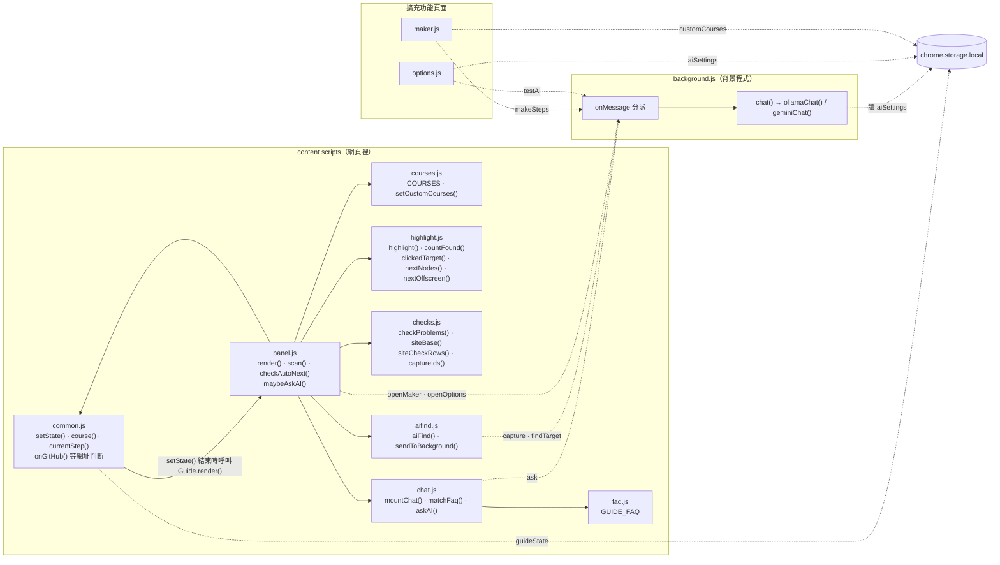
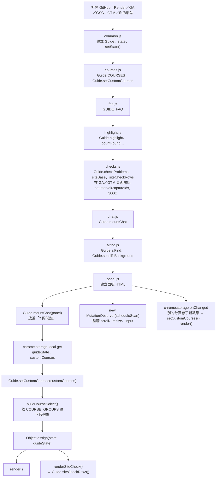
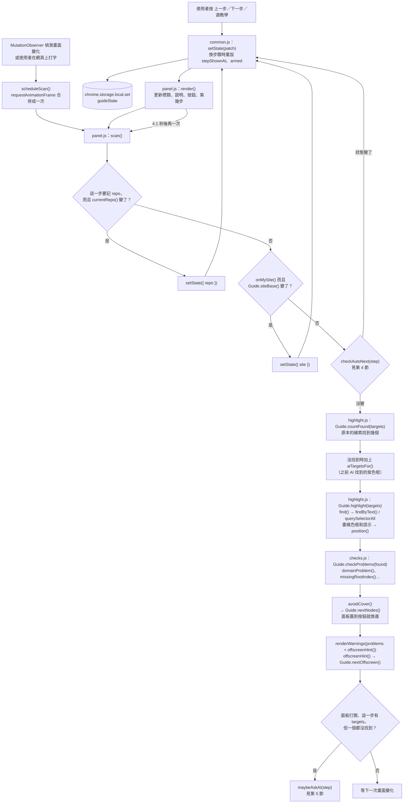
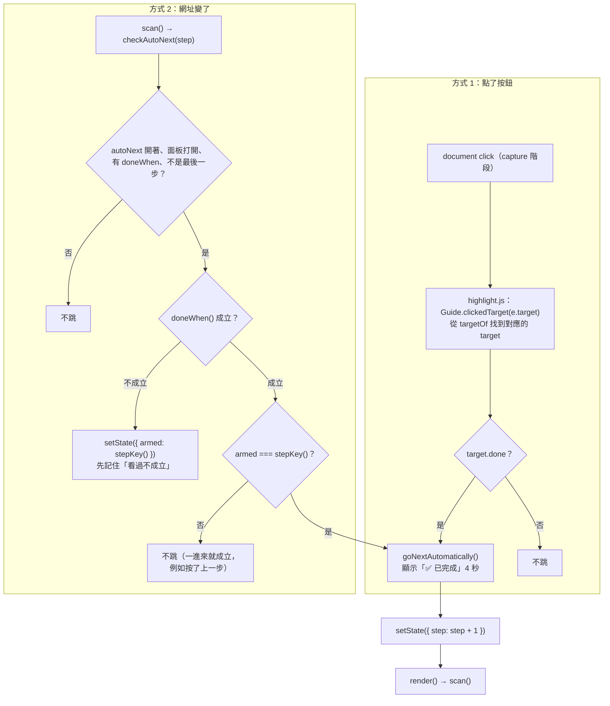
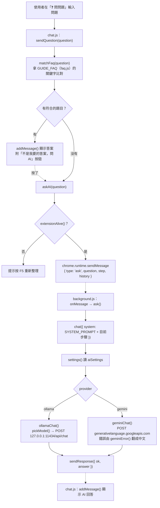
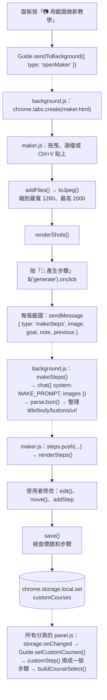
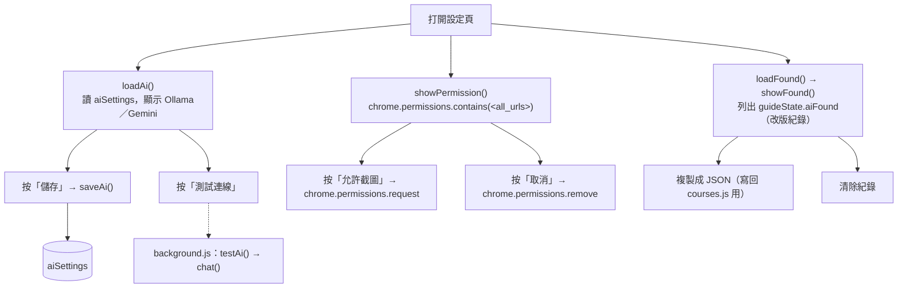
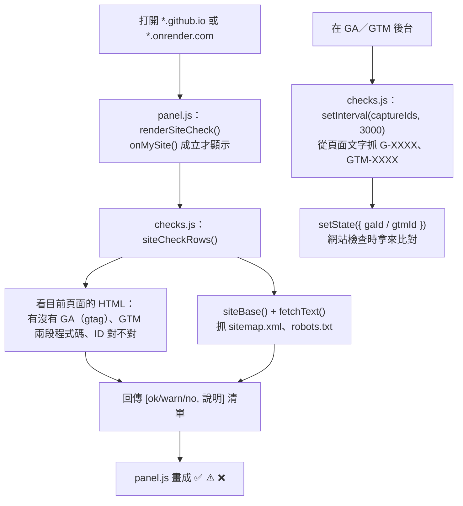

# 程式流程圖

2026-10-30（對應 manifest 版本 6.1）

這份文件用流程圖說明每個檔案、每個函數之間怎麼互相呼叫。整體架構和每個檔案的用途請看 [ARCHITECTURE.md](ARCHITECTURE.md)。

圖裡的寫法：`檔案.js：函數()`。虛線箭頭（`-.->`）是跨程式傳訊息（`chrome.runtime.sendMessage`）或讀寫 `chrome.storage`。

## 1. 總覽：誰呼叫誰



## 2. 載入和啟動

Chrome 依 `manifest.json` 的順序載入 8 個檔案。前 7 個只是把函數掛到全域物件 `Guide` 上，最後的 `panel.js` 才真正開始動作。



## 3. 畫面和掃描：render() → scan()

這是最核心的循環。任何狀態改變都會走 `setState()` → `render()` → `scan()`；網頁畫面一變，`MutationObserver` 也會叫 `scan()`。



## 4. 自動跳下一步

有兩種方式：點了框起來的按鈕（target 有 `done: true`），或網址變了（步驟的 `doneWhen()` 從不成立變成成立）。



## 5. AI 找按鈕

```mermaid
sequenceDiagram
  participant P as panel.js
  participant A as aifind.js
  participant H as highlight.js
  participant B as background.js
  participant S as chrome.storage
  participant AI as Ollama / Gemini

  P->>P: maybeAskAI(step)<br/>檢查 aiFind 開關、這頁沒問過、在正確頁面、已過 4 秒
  P->>A: Guide.aiFind(step)
  A->>A: collectCandidates()<br/>最多 50 個可點元素，編號
  A->>A: hideOverlay(true) 先藏起面板
  A->>B: sendMessage capture（元素位置、視窗大小）
  B->>B: capture()<br/>有 &lt;all_urls&gt; 權限？canSeeImages()？
  B->>B: captureVisibleTab → OffscreenCanvas 畫粉紅框和編號
  B-->>A: { image } 或 { image: null, why }
  A->>A: hideOverlay(false)
  A->>B: sendMessage findTarget（步驟、原本的線索、元素清單、截圖）
  B->>B: findTarget() → chat()
  B->>S: settings() 讀 aiSettings
  B->>AI: ollamaChat() 或 geminiChat()
  AI-->>B: {"index": 編號, "reason": "…"}
  B->>B: parseJson()
  B-->>A: { index, reason, model, mode }
  A->>A: targetFor(node)<br/>轉成之後還找得到的 selector / text
  A-->>P: { target, reason }
  P->>S: setState({ aiFound }) 依 aiKey() 存起來
  P->>P: render() → scan()
  P->>H: Guide.highlight([...targets, ...aiTargetsFor()])<br/>畫紫色虛線框
```

## 6. 問問題



## 7. 用截圖做教學（maker.html）



## 8. 設定頁（options.html）



## 9. 網站檢查（在你自己的網站上）


